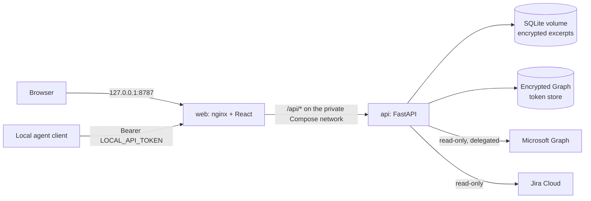

# Magic Tower

[](https://github.com/WitchyNibbles/magic_tower/actions/workflows/ci.yml)


Magic Tower is a local-first task queue built from the work that arrives in your Outlook inbox and Jira. It reads mail through Microsoft Graph, decides with a deterministic rule set which messages are actual work, and shows those as reviewable work items with the evidence that put them there. Local agent clients can read that queue and report back through a loopback-only API.

Everything runs on your own machine. Nothing is fetched until you connect a source, nothing is ever sent or changed in Microsoft 365 or Jira, and message content is encrypted at rest.

## Features

- **Outlook ingestion** over Microsoft Graph with delegated, read-only OAuth (authorization code + PKCE, `offline_access`, automatic token refresh, `@odata.nextLink` paging, and `Retry-After` backoff on 429/503).
- **Jira ingestion** of issues you are assigned to, reported, created, watch, or voted on, plus an optional browse-only management project (`docs/jira-setup.md`).
- **Rule-based promotion** (`backend/app/services/promotion.py`): no LLM and no network, so the same message always gets the same decision, and the rules can be scored against a hand-labeled sample of real mail.
- **Review queue UI** to filter, inspect, update, dismiss, and hand off work items, each with its source evidence.
- **Agent API** on loopback: clients read bounded context, propose work items, and record dispatch progress (`docs/agent-protocol.md`).

## Architecture



| Component | Stack | Responsibility |
| --- | --- | --- |
| `frontend/` | React 19, TypeScript, Vite, Tailwind CSS, served by nginx | Review queue UI; talks only to same-origin `/api/*`. |
| `backend/` | Python 3.12, FastAPI, SQLAlchemy, Alembic, uv | Work queue, source sync, promotion rules, OAuth, agent API. |
| `docker-compose.yml` | Docker Compose | Publishes the web service on loopback only; the API is reachable only inside the Compose network. |

A sync (`POST /api/sync`, or `POST /api/sync?kind=jira`) reads a source, stores every signal as a `Source`, and promotes the actionable ones into `WorkItem` rows with `WorkEvidence`. More detail is in [`docs/architecture.md`](docs/architecture.md).

## Quick start

Requires Docker with Compose.

```sh
cp .env.example .env
docker compose up --build
```

Open [http://localhost:8787](http://localhost:8787). The web service binds to loopback only; the API stays inside the Compose network. Stop with `docker compose down`; persistent SQLite data is held in the `workboard-data` Docker volume, and the API container runs `alembic upgrade head` before it serves.

If something else on the host already holds 8787, set `WEB_PORT` before bringing the stack up
(`WEB_PORT=9191 docker compose up --build`, then open `http://localhost:9191`); the bind stays
loopback-only either way. A changed port also needs `MICROSOFT_REDIRECT_URI` moved to it --
it is not derived from `WEB_PORT` -- and that same URI registered in Entra, or Graph sign-in
cannot complete.

On first use, enter the separately generated `LOCAL_API_TOKEN` in the browser to create an HttpOnly, eight-hour local session. The typed value is not persisted in browser storage; cookie-backed writes also require CSRF protection.

### Configuration

All settings live in `.env`; [`.env.example`](.env.example) lists every one with a comment.

| Variable | Needed for |
| --- | --- |
| `LOCAL_API_TOKEN` | Signing in to the UI and authenticating agent clients. Generate a random value. |
| `APP_ENCRYPTION_KEY` | Encrypting the Graph token store and stored message excerpts. Without it the API refuses to store or serve them. |
| `MICROSOFT_TENANT_ID`, `MICROSOFT_CLIENT_ID`, `MICROSOFT_CLIENT_SECRET`, `MICROSOFT_TARGET_USER_ID`, `MICROSOFT_REDIRECT_URI` | Outlook sync. See [Configure the Graph familiar](#configure-the-graph-familiar). |
| `JIRA_SITE_URL`, `JIRA_ACCOUNT_EMAIL`, `JIRA_API_TOKEN`, `JIRA_MANAGEMENT_PROJECT_KEY` | Jira sync. See [`docs/jira-setup.md`](docs/jira-setup.md). |
| `PROMOTION_ALLOWLISTED_SENDERS` | Optional senders whose mail is always treated as work. |

## Security

Magic Tower is designed for a trusted local host, not for exposure to a network.

- **Loopback only.** The web service publishes on `127.0.0.1`; the API has no published port at all.
- **Encryption at rest.** Graph tokens and stored message excerpts are AES-GCM encrypted under `APP_ENCRYPTION_KEY`, with separate associated data so one can never be decrypted as the other. Writes fail closed (503) without a key.
- **Least-privilege Graph access.** Exactly three delegated scopes (`offline_access`, `User.Read`, `Mail.Read`), `/me` endpoints only, and a sign-in whose object ID differs from `MICROSOFT_TARGET_USER_ID` is rejected. The connector never sends mail or writes to Microsoft 365.
- **No credentials in the browser or agents.** OAuth uses PKCE with a one-time encrypted state; tokens never leave the backend. Agents get a separate `LOCAL_API_TOKEN`, never a Graph token.
- **Browser session hardening.** An HttpOnly session cookie stored only as a SHA-256 hash in SQLite (so sessions survive an API restart but a copy of the database cannot be replayed), CSRF protection on cookie-backed writes, `no-store` caching, `nosniff`, `X-Frame-Options: DENY`, and a JSON body size limit.
- **Hardened containers.** The API container runs read-only with all capabilities dropped and `no-new-privileges`.

This does not protect against a compromised browser profile, Docker host, or local administrator. Keep `.env` local, and retain only the source excerpts needed to explain a work suggestion.

## Development

```sh
cd backend
uv sync
DATABASE_URL=sqlite:///./workboard.db uv run alembic upgrade head
DATABASE_URL=sqlite:///./workboard.db uv run uvicorn app.main:app --reload
uv run pytest

cd ../frontend
npm ci
npm run dev
npm run test -- --run
```

CI (`.github/workflows/ci.yml`) runs the backend suite, the frontend suite, and a Docker Compose build on every push and pull request. Interactive API docs are served at `/api/docs`.

## License

Magic Tower is released under the [MIT License](LICENSE).

---

## Inside the tower

*A quiet, local-first tower for tending the work that finds you.*

Microsoft Graph ingestion and agent-driven work extraction are deliberately opt-in: nothing crosses the threshold until you invite it in. The sections below are the longer grimoire: every detail of running, migrating, and measuring the tower.

## Develop the API with uv

The backend is a standalone [uv](https://docs.astral.sh/uv/) project pinned to Python 3.12. From the repository root:

```sh
cd backend
uv sync
DATABASE_URL=sqlite:///./workboard.db uv run alembic upgrade head
DATABASE_URL=sqlite:///./workboard.db uv run uvicorn app.main:app --reload
```

`/data` is the Docker data directory, so the `DATABASE_URL` override gives a
local checkout a writable SQLite database. If you enable Microsoft Graph,
also set `TOKEN_STORE_PATH` and `OAUTH_STATE_STORE_PATH` to writable local
paths.

Run the backend test command from `backend/`:

```sh
cd backend
uv run pytest
```

The suite must run from `backend/` because `app/config.py:13` sets
`env_file=".env"`, which is resolved relative to the current working
directory. From the repository root, pytest would load the root `.env`
instead, whose empty `MICROSOFT_*` values fail Settings validation and abort
collection.

When dependencies move, update the committed lockfile with `uv lock`.

## Migrate the schema with Alembic

Alembic owns every table. The application creates none of its own at startup, so a
database must be migrated before it can serve a request. `backend/alembic.ini`
holds no URL: `backend/alembic/env.py` reads `DATABASE_URL` through the same
`app.config.get_settings` the API uses, so both always open the same file.

```sh
cd backend
DATABASE_URL=sqlite:///./workboard.db uv run alembic upgrade head                            # apply
DATABASE_URL=sqlite:///./workboard.db uv run alembic revision --autogenerate -m "what changed"
```

Commit the generated revision together with the `app/models.py` change that motivated
it; `tests/test_migrations.py` fails if the chain and the models drift apart.

**A database created before Alembic existed** (a `workboard.db` or `workboard-data`
volume left by the old `create_all` startup hook) already holds the baseline
tables. Revision `0001` detects that -- by column as well as by table name, so a
schema altered by hand since cannot pass as an untouched one -- and records itself
without recreating them, so plain `alembic upgrade head` -- which the API container
now runs before serving -- works unchanged on such a database. Marking it
explicitly is equivalent:

```sh
cd backend
DATABASE_URL=sqlite:///./workboard.db uv run alembic stamp 0001
```

If those tables are present but their columns are not the ones `0001` creates, the
upgrade fails and names the difference, leaving the database unstamped. No later
revision recreates a column `0001` skipped, so stamping over such a database would
strand it: repair the schema by hand, or recreate the database, before migrating.

## Install the API command with uv

To install the API command into uv's tool environment from a local checkout:

```sh
cd backend
uv tool install --editable .
magic-tower-api app.main:app --reload
```

Set `DATABASE_URL=sqlite:///./workboard.db` before starting the command if you
want a writable SQLite database in the checkout.

## Configure the Graph familiar

Register a Microsoft Entra application for the intended work/school account. Add the exact redirect URI `http://localhost:8787/api/auth/callback` (matching `MICROSOFT_REDIRECT_URI`, so use your own port if you changed `WEB_PORT`), configure delegated read-only scopes `User.Read`, `Mail.Read`, and `offline_access`, then set the tenant, client, target object ID, and separately generated `APP_ENCRYPTION_KEY` in `.env`. The connector uses `/me` only and rejects a sign-in whose object ID does not match `MICROSOFT_TARGET_USER_ID`.

Use `GET /api/auth/microsoft/start` to begin sign-in, then `POST /api/sync` to import bounded Outlook metadata. It never sends messages or acts in Microsoft 365.

If the database holds `sources` rows written before the promotion heuristic existed, call `POST /api/sync/backfill` once to offer them to it; it never runs on its own (not at startup, not from `POST /api/sync`), reaches no network, and is safe to call again -- a source it has already judged, promoted or not, is never re-judged. Its response reports `considered`, `new_work_items`, `judged_without_context` and `promoted_without_owner_check` separately, because a bare `new_work_items` count cannot tell "nothing left to backfill" apart from "backfilled some and the heuristic declined all of it".

The backfill judges slightly less well than a live sync does, and the last two counts are how it says so. `judged_without_context` counts rows stored before the sender and headers were kept at all, which can only be promoted unconditionally. `promoted_without_owner_check` counts rows promoted without the "skip mail you were only copied on" rule: that rule needs your own addresses, only the live Graph profile has them, and nothing stores them -- so **mail you were merely Cc'd on is promoted by the backfill even though a sync would decline it**. Both counts are rows worth reviewing in the queue, not errors; dismiss what does not belong.

## Measure the heuristic against real mail

The promotion heuristic in `app/services/promotion.py` can only be trusted once it has been checked against real mail, but real mail must never enter this repository. This is a two-machine workflow: sign in and sync on the machine with Outlook access, then hand-label and evaluate.

`heuristic_export` reads the database a sync wrote to and never talks to Microsoft Graph. `heuristic_eval` reads only the labeled-sample JSON file it produces -- no database, no Graph credentials -- so it also runs safely on a machine that has never synced real mail: with no sample file present it prints a message and exits 0, and `MAGIC_TOWER_REQUIRE_SAMPLE=1` turns that (and an exported-but-never-labeled sample) into a hard failure instead, for the one run that is meant to prove the heuristic was actually checked. See `app/tools/labeled-sample.example.json` for the (entirely synthetic) row shape.

See [`docs/second-pc.md`](docs/second-pc.md) for the full, ordered, pasteable sequence -- from `git clone` to a printed precision/recall number -- including every prerequisite (the five `MICROSOFT_*` settings, `APP_ENCRYPTION_KEY`, and `LOCAL_API_TOKEN`) and exactly how far it runs without real Microsoft credentials.

## Summon an agent

Set a separate random `LOCAL_API_TOKEN` in `.env` and give it to the local agent client, which sends it as a Bearer header to the loopback API. It is a Magic Tower-only credential, never an Azure or Graph token. See [the agent protocol](docs/agent-protocol.md) for the intake and dispatch contracts.
