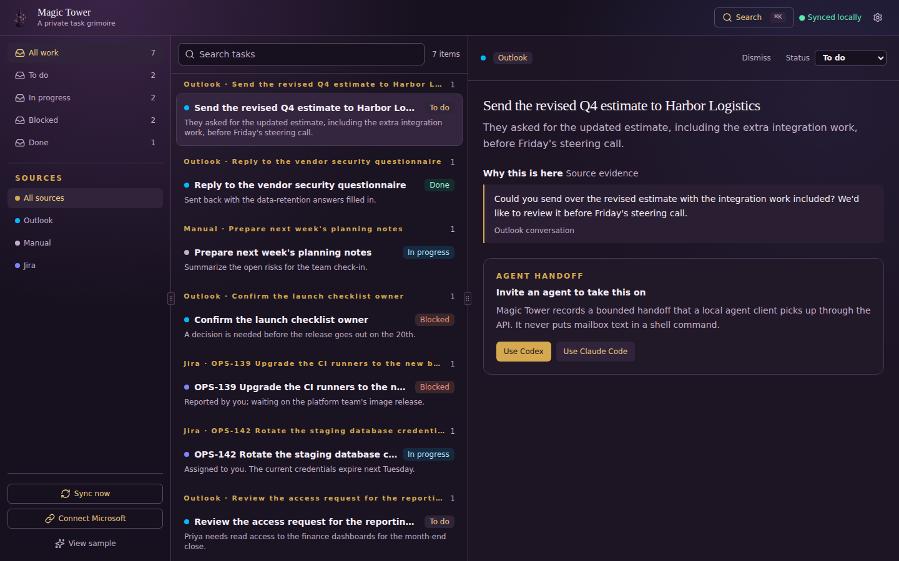
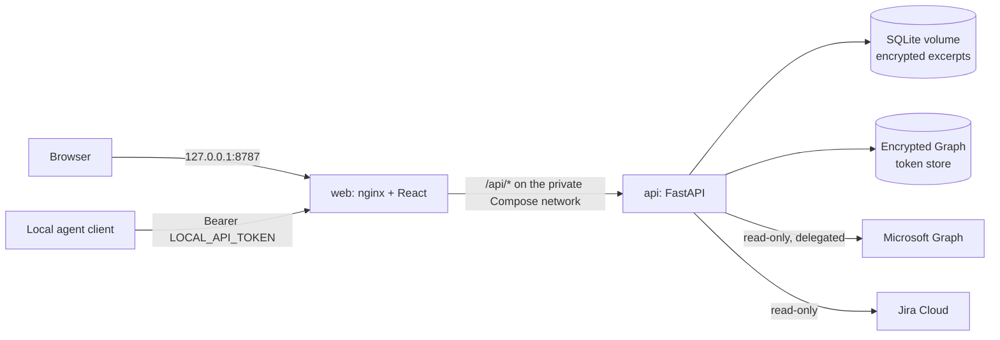

# Magic Tower

[](https://github.com/WitchyNibbles/magic_tower/actions/workflows/ci.yml)


Magic Tower is a local-first task queue built from the work that arrives in your Outlook inbox and Jira. It reads mail through Microsoft Graph, decides with a deterministic rule set which messages are actual work, and shows those as reviewable work items with the evidence that put them there. Local agent clients can read that queue and report back through a loopback-only API.

Everything runs on your own machine. Nothing is fetched until you connect a source, nothing is ever sent or changed in Microsoft 365 or Jira, and message content is encrypted at rest.



*The review queue with sample data. Every item shows the evidence that put it there.*

## Features

- **Outlook ingestion** over Microsoft Graph with delegated, read-only OAuth (authorization code + PKCE, `offline_access`, automatic token refresh, `@odata.nextLink` paging, and `Retry-After` backoff on 429/503).
- **Jira ingestion** of issues you are assigned to, reported, created, watch, or voted on, plus an optional browse-only management project (`docs/jira-setup.md`). Each sync picks up where the last good one stopped.
- **Scheduled sync** of every ready source every `SYNC_INTERVAL_MINUTES` (default 10), plus a sync button that runs all of them on demand.
- **Rule-based promotion** (`backend/app/services/promotion.py`): no LLM and no network, so the same message always gets the same decision, and the rules can be scored against a hand-labeled sample of real mail.
- **Review queue UI** to filter, inspect, update, dismiss, and hand off work items, each with its source evidence.
- **Agent API** on loopback: clients read bounded context, propose work items, and record dispatch progress (`docs/agent-protocol.md`).

## Architecture



| Component | Stack | Responsibility |
| --- | --- | --- |
| `frontend/` | React 19, TypeScript, Vite, Tailwind CSS, served by nginx | Review queue UI; talks only to same-origin `/api/*`. |
| `backend/` | Python 3.12, FastAPI, SQLAlchemy, Alembic, uv | Work queue, source sync, promotion rules, OAuth, agent API. |
| `docker-compose.yml` | Docker Compose | Publishes the web service on loopback only; the API is reachable only inside the Compose network. |

A sync (`POST /api/sync`, `POST /api/sync?kind=jira`, or `POST /api/sync/all` for every ready source, which is also what the schedule runs) reads a source, stores every signal as a `Source`, and promotes the actionable ones into `WorkItem` rows with `WorkEvidence`. More detail is in [`docs/architecture.md`](docs/architecture.md).

## Quick start

Requires Docker with Compose.

```sh
cp .env.example .env
docker compose up --build
```

Open [http://localhost:8787](http://localhost:8787). The web service binds to loopback only; the API stays inside the Compose network. Stop with `docker compose down`; persistent SQLite data is held in the `workboard-data` Docker volume, and the API container runs `alembic upgrade head` before it serves.

If something else on the host already holds 8787, set `WEB_PORT` before bringing the stack up
(`WEB_PORT=9191 docker compose up --build`, then open `http://localhost:9191`); the bind stays
loopback-only either way. A changed port also needs `MICROSOFT_REDIRECT_URI` moved to it --
it is not derived from `WEB_PORT` -- and that same URI registered in Entra, or Graph sign-in
cannot complete.

On first use, enter the separately generated `LOCAL_API_TOKEN` in the browser to create an HttpOnly, eight-hour local session. The typed value is not persisted in browser storage; cookie-backed writes also require CSRF protection.

### Configuration

All settings live in `.env`; [`.env.example`](.env.example) lists every one with a comment.

| Variable | Needed for |
| --- | --- |
| `LOCAL_API_TOKEN` | Signing in to the UI and authenticating agent clients. Generate a random value. |
| `APP_ENCRYPTION_KEY` | Encrypting the Graph token store and stored message excerpts. Without it the API refuses to store or serve them. |
| `MICROSOFT_TENANT_ID`, `MICROSOFT_CLIENT_ID`, `MICROSOFT_CLIENT_SECRET`, `MICROSOFT_TARGET_USER_ID`, `MICROSOFT_REDIRECT_URI` | Outlook sync. See [`docs/microsoft-graph.md`](docs/microsoft-graph.md). |
| `JIRA_SITE_URL`, `JIRA_ACCOUNT_EMAIL`, `JIRA_API_TOKEN`, `JIRA_MANAGEMENT_PROJECT_KEY` | Jira sync. See [`docs/jira-setup.md`](docs/jira-setup.md). |
| `PROMOTION_ALLOWLISTED_SENDERS` | Optional senders whose mail is always treated as work. |
| `SYNC_INTERVAL_MINUTES` | Minutes between scheduled syncs of every ready source. Default 10; `0` turns the schedule off. |
| `JIRA_SYNC_LOOKBACK_DAYS` | How far back a first Jira sync looks, and the cap after a long gap. Default 14. |

## Security

Magic Tower is designed for a trusted local host, not for exposure to a network.

- **Loopback only.** The web service publishes on `127.0.0.1`; the API has no published port at all.
- **Encryption at rest.** Graph tokens and stored message excerpts are AES-GCM encrypted under `APP_ENCRYPTION_KEY`, with separate associated data so one can never be decrypted as the other. Writes fail closed (503) without a key.
- **Least-privilege Graph access.** Exactly three delegated scopes (`offline_access`, `User.Read`, `Mail.Read`), `/me` endpoints only, and a sign-in whose object ID differs from `MICROSOFT_TARGET_USER_ID` is rejected. The connector never sends mail or writes to Microsoft 365.
- **No credentials in the browser or agents.** OAuth uses PKCE with a one-time encrypted state; tokens never leave the backend. Agents get a separate `LOCAL_API_TOKEN`, never a Graph token.
- **Browser session hardening.** An HttpOnly session cookie stored only as a SHA-256 hash in SQLite (so sessions survive an API restart but a copy of the database cannot be replayed), CSRF protection on cookie-backed writes, `no-store` caching, `nosniff`, `X-Frame-Options: DENY`, and a JSON body size limit.
- **Hardened containers.** The API container runs read-only with all capabilities dropped and `no-new-privileges`.

This does not protect against a compromised browser profile, Docker host, or local administrator. Keep `.env` local, and retain only the source excerpts needed to explain a work suggestion.

## Development

```sh
cd backend
uv sync
DATABASE_URL=sqlite:///./workboard.db uv run alembic upgrade head
DATABASE_URL=sqlite:///./workboard.db uv run uvicorn app.main:app --reload
uv run pytest

cd ../frontend
npm ci
npm run dev
npm run test -- --run
```

Migrations, the uv tool install, and pre-Alembic databases are covered in [`docs/development.md`](docs/development.md). CI (`.github/workflows/ci.yml`) runs the backend suite, the frontend suite, and a Docker Compose build on every push and pull request. Interactive API docs are served at `/api/docs`.

---

## Inside the tower

*A quiet, local-first tower for tending the work that finds you.*

Nothing crosses the threshold until you invite it in. The rest of the grimoire lives in `docs/`:

- **[Raising the tower from source](docs/development.md)**: uv, Alembic, and the old databases that predate the migrations.
- **[Binding the Graph familiar](docs/microsoft-graph.md)**: the Entra registration, the first sync, and the backfill that offers older mail to the heuristic.
- **[Testing the heuristic on real mail](docs/second-pc.md)**: the two-machine ritual that ends in a precision/recall number, without real mail ever touching this repository.
- **[Summoning Jira](docs/jira-setup.md)**: connecting a real Jira Cloud site and checking what comes back.
- **[The agent's pact](docs/agent-protocol.md)**: what a local agent may read, propose, and report.
- **[The tower's plan](docs/architecture.md)**: components, boundaries, and how a sync moves through them.

## License

Magic Tower is released under the [MIT License](LICENSE).
